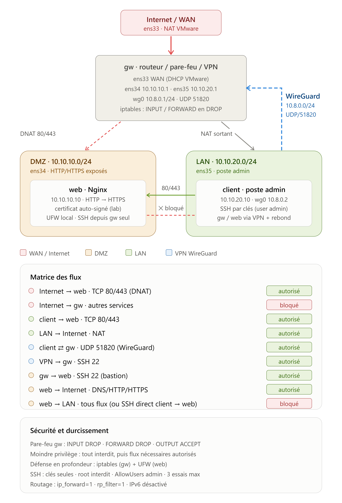

# Mini-projet S2 - Lab réseau 3 VMs

> **Domaine :** Réseau, Linux & Cybersécurité  
> **Technologies :** Debian, VMware, iptables, Nginx, WireGuard, SSH  
> **Architecture :** WAN / DMZ / LAN / VPN WireGuard

---

## Objectif du projet

Ce mini-projet consiste à mettre en place une architecture réseau sécurisée composée de **3 machines virtuelles Debian** :

- `gw` : routeur, pare-feu et passerelle VPN
- `web` : serveur web Nginx placé dans une DMZ
- `client` : poste d'administration placé dans le LAN

Le routeur `gw` constitue le point central de l'architecture. Il assure :

- le routage entre les différents réseaux ;
- le NAT vers Internet ;
- le filtrage réseau avec `iptables` ;
- la redirection HTTP/HTTPS vers le serveur web ;
- l'accès d'administration sécurisé avec WireGuard.

L'objectif principal est d'appliquer le principe de **moindre privilège** avec une politique de filtrage restrictive.

---

## Architecture réseau

Le schéma suivant présente l'architecture complète du lab avec les zones **WAN**, **DMZ** et **LAN**, le pare-feu `iptables`, le serveur web Nginx et le tunnel VPN WireGuard.




## Plan d'adressage

| Machine | Rôle | Interface | Adresse IP |
|---|---|---|---|
| `gw` | WAN | `ens33` | DHCP VMware |
| `gw` | Gateway DMZ | `ens34` | `10.10.10.1/24` |
| `gw` | Gateway LAN | `ens35` | `10.10.20.1/24` |
| `gw` | WireGuard | `wg0` | `10.8.0.1/24` |
| `web` | Serveur Nginx | `ens33` | `10.10.10.10/24` |
| `client` | Poste admin | `ens33` | `10.10.20.10/24` |
| `client` | WireGuard | `wg0` | `10.8.0.2/24` |

---

## Segmentation réseau

L'architecture est divisée en trois zones.

### WAN

Le WAN représente l'accès vers Internet.

Seule la machine `gw` possède une interface directement connectée au réseau NAT VMware.

---

### DMZ

Sous-réseau :

```text
10.10.10.0/24
```

La DMZ contient le serveur web :

```text
web = 10.10.10.10
```

Le serveur expose uniquement les services HTTP et HTTPS.

---

### LAN

Sous-réseau :

```text
10.10.20.0/24
```

Le LAN contient le poste d'administration :

```text
client = 10.10.20.10
```

Le client utilise également WireGuard pour administrer l'infrastructure.

---

## Matrice des flux

| Source | Destination | Service | Décision |
|---|---|---|---|
| Internet | web | TCP 80 | ✅ Autorisé |
| Internet | web | TCP 443 | ✅ Autorisé |
| Internet | gw | Autres services | ❌ Bloqué |
| LAN | web | TCP 80/443 | ✅ Autorisé |
| LAN | Internet | NAT | ✅ Autorisé |
| LAN | gw | UDP 51820 | ✅ WireGuard |
| VPN | gw | SSH 22 | ✅ Autorisé |
| gw | web | SSH 22 | ✅ Autorisé |
| web | Internet | DNS/HTTP/HTTPS | ✅ Autorisé |
| web | LAN | Tous | ❌ Bloqué |
| client | web SSH direct | TCP 22 | ❌ Bloqué |

La politique générale du pare-feu est :

```text
Tout interdire par défaut,
puis autoriser uniquement les flux nécessaires.
```

---

## Routage

Le routage IPv4 est activé sur `gw`.

Fichier :

```text
/etc/sysctl.d/99-router.conf
```

Configuration principale :

```ini
net.ipv4.ip_forward=1
net.ipv4.conf.all.rp_filter=1
net.ipv4.conf.default.rp_filter=1
net.ipv4.conf.all.accept_redirects=0
net.ipv4.conf.all.send_redirects=0
net.ipv6.conf.all.disable_ipv6=1
net.ipv6.conf.default.disable_ipv6=1
```

Vérification :

```bash
cat /proc/sys/net/ipv4/ip_forward
```

Résultat attendu :

```text
1
```

---

## NAT

Les machines du LAN et de la DMZ utilisent `gw` pour accéder à Internet.

Le NAT est réalisé avec :

```bash
iptables -t nat -A POSTROUTING -o ens33 -s 10.10.20.0/24 -j MASQUERADE
iptables -t nat -A POSTROUTING -o ens33 -s 10.10.10.0/24 -j MASQUERADE
```

---

## Serveur web

La VM `web` héberge un serveur :

```text
Nginx
```

Services disponibles :

```text
HTTP  : TCP/80
HTTPS : TCP/443
```

HTTP est redirigé vers HTTPS.

Un certificat auto-signé est utilisé pour HTTPS dans le cadre du lab.

---

## DNAT

Les connexions provenant d'Internet vers :

```text
WAN_IP:80
WAN_IP:443
```

sont redirigées vers :

```text
10.10.10.10
```

avec `iptables`.

```text
Internet
    |
    | TCP 80 / 443
    v
+---------+
|   gw    |
| DNAT    |
+----+----+
     |
     v
10.10.10.10
    web
```

---

## Pare-feu

Le pare-feu principal est installé sur `gw` avec `iptables`.

Politiques :

```text
INPUT   DROP
FORWARD DROP
OUTPUT  ACCEPT
```

Le serveur `web` possède également un pare-feu local avec UFW.

Cette approche permet une **défense en profondeur**.

---

## VPN WireGuard

L'administration de l'infrastructure passe par un tunnel WireGuard.

```text
client                     gw
10.8.0.2                   10.8.0.1
    |                         |
    +======== VPN ============+
             UDP/51820
```

Le SSH de `gw` est accessible uniquement depuis le VPN.

Administration :

```bash
ssh gw
```

Pour administrer le serveur web, `gw` est utilisé comme bastion :

```bash
ssh web
```

avec :

```text
client -> WireGuard -> gw -> SSH -> web
```

---

## Sécurité SSH

SSH est configuré avec :

```text
PermitRootLogin no
PasswordAuthentication no
AllowUsers admin
MaxAuthTries 3
```

L'administration utilise des clés SSH.

Le serveur `web` accepte SSH uniquement depuis :

```text
10.10.10.1
```

c'est-à-dire le routeur `gw`.

---

## Tests de validation

### Internet du client

```bash
curl -I https://deb.debian.org
```

Résultat attendu :

```text
HTTP 200 / 301
```

---

### HTTPS depuis le LAN

```bash
curl -kI https://10.10.10.10
```

Résultat attendu :

```text
HTTP/1.1 200 OK
```

---

### SSH direct client -> web

```bash
nc -zv -w3 10.10.10.10 22
```

Résultat attendu :

```text
timeout
```

---

### WireGuard

```bash
sudo wg show
```

Puis :

```bash
ping 10.8.0.1
```

Le tunnel doit être établi.

---

### SSH vers gw via VPN

```bash
ssh gw hostname
```

Résultat attendu :

```text
gw
```

---

### SSH vers web avec rebond

```bash
ssh web hostname
```

Résultat attendu :

```text
web
```

---

### Isolation DMZ -> LAN

Depuis `web` :

```bash
nc -zv -w3 10.10.20.10 22
```

Résultat attendu :

```text
timeout
```

---

## Structure du projet

```text
mini-projet-lab-3vms/
├── README.md
│
├── docs/
│   ├── schema-reseau.drawio
│   └── schema-reseau.png
│
├── gw/
│   ├── README.md
│   ├── firewall.sh
│   ├── interfaces
│   ├── 99-router.conf
│   ├── rules.v4
│   └── wg0.conf.example
│
├── web/
│   ├── README.md
│   ├── interfaces
│   ├── nginx-lab.conf
│   └── ufw-setup.sh
│
└── client/
    ├── README.md
    ├── interfaces
    ├── wg0.conf.example
    └── ssh_config.example
```

---

## Sécurité du dépôt

Les informations sensibles ne doivent jamais être envoyées sur GitHub.

À exclure :

```text
wg0.conf
*.key
*.pem
privatekey
*.log
```

Les clés privées WireGuard et SSH ne doivent jamais être versionnées.

---

## Technologies utilisées

- Debian GNU/Linux
- VMware Workstation
- Linux networking
- iptables
- NAT / DNAT
- Nginx
- HTTPS / TLS
- WireGuard
- SSH
- UFW
- tcpdump
- conntrack
- nmap
- Git
- GitHub

---

## Compétences mises en pratique

Ce projet permet de travailler sur :

- l'administration Linux ;
- le routage IPv4 ;
- la segmentation LAN / DMZ / WAN ;
- le filtrage réseau avec iptables ;
- le NAT et le DNAT ;
- la sécurisation d'un serveur web ;
- la configuration de Nginx ;
- les tunnels VPN WireGuard ;
- le durcissement SSH ;
- l'analyse réseau avec tcpdump ;
- la validation des règles de sécurité ;
- la documentation technique avec Git et GitHub.

